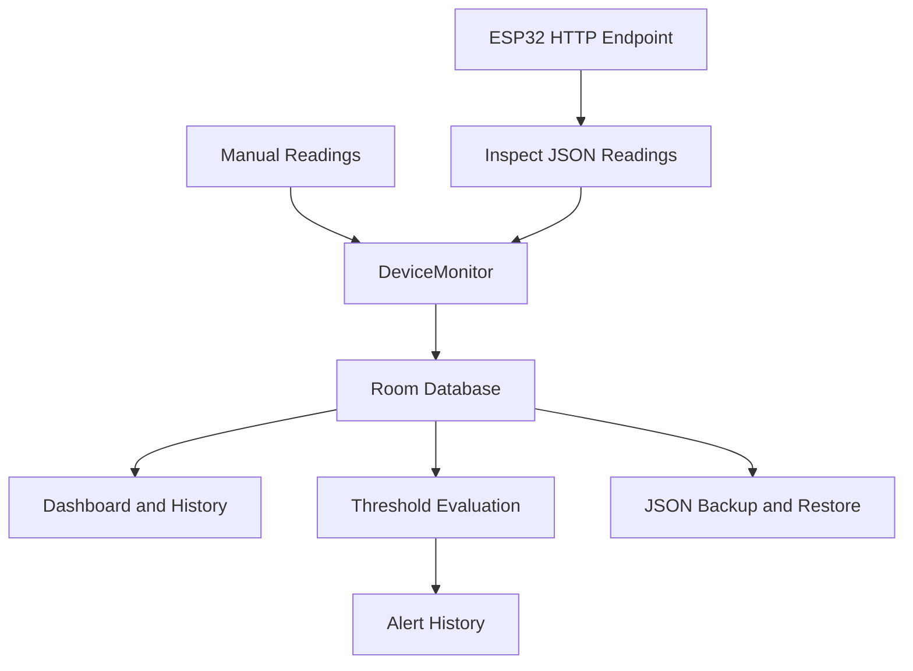

 <div align="center">

# DeviceMonitor

### Your IoT devices. Your readings. One clear view.

A native Android application for organizing IoT devices, recording sensor readings, reviewing trends and managing threshold alerts.


</div>

---

## Overview

DeviceMonitor is a local-first Android application that brings IoT device records and sensor readings into one place. Add devices, record measurements, explore historical data and configure threshold alerts to monitor values that matter to you.

For compatible ESP32 devices, the app can connect to an HTTP endpoint, inspect the returned JSON readings and let you choose which values to save.

DeviceMonitor stores account profiles and monitoring data locally on your Android device. It does not currently provide hosted accounts or automatic cloud synchronization.

## App Preview

<table>
<tr>
<td width="50%">

**Sign In**


</td>
<td width="50%">

**Registration**


</td>
</tr>
<tr>
<td>

**Dashboard**


</td>
<td>

**Devices**


</td>
</tr>
<tr>
<td>

**Sensor Details**


</td>
<td>

**Alerts**


</td>
</tr>
<tr>
<td colspan="2" align="center">

**Settings and Data Management**


</td>
</tr>
</table>

*Add genuine screenshots captured from the running application to `docs/screenshots/` using the filenames above.*

## Features

| Feature | Description |
|---|---|
| **Monitoring dashboard** | Review device summaries, recent readings and monitoring activity. |
| **Device management** | Add, edit, view and delete devices with their names, types, locations and notes. |
| **Flexible sensor records** | Store readings with values, units, timestamps and source information. |
| **Reading history** | Explore historical sensor data and chart summaries. |
| **Threshold alerts** | Configure numeric thresholds, review triggered alerts and acknowledge them. |
| **ESP32 HTTP support** | Connect to compatible endpoints, inspect JSON responses and selectively save readings. |
| **Personal preferences** | Configure supported appearance and temperature-unit settings. |
| **Backup and restore** | Export monitoring data as JSON and restore it later. |
| **Local accounts** | Register and sign in using a profile stored on the device. |

## Architecture



DeviceMonitor supports different sensor types without giving one category automatic priority. Examples include temperature, humidity, soil moisture, light intensity, pressure, battery level and custom numeric measurements.

Manual entries and readings received from an endpoint should remain distinguishable by their source.

## Technology Stack

| Technology | Purpose |
|---|---|
| Kotlin | Application development |
| Jetpack Compose | Native Android user interface |
| Material 3 | UI components and theming |
| AndroidX Room | Local SQLite database |
| Coroutines and Flow | Asynchronous operations and observable data |
| OkHttp | HTTP communication with compatible ESP32 endpoints |
| JUnit and Robolectric | Unit testing |
| Inter and Manrope | Application typography |

## Getting Started

### Requirements

- Android Studio compatible with the project's Android Gradle Plugin
- JDK 17 or a version supported by the configured build tools
- Android SDK Platform 36
- An Android emulator or physical device running Android 7.0 or later

### Run the Application

1. Clone or download the repository.
2. Open the project root in Android Studio.
3. Allow Gradle synchronization to finish and install any requested SDK components.
4. Start an emulator or connect an Android device with USB debugging enabled.
5. Select the `app` run configuration and click **Run**.

If a compatible Gradle installation is available on your `PATH`, use:

```bash
gradle assembleDebug
gradle :app:testDebugUnitTest
```

The debug APK is normally generated at:

```text
app/build/outputs/apk/debug/app-debug.apk
```

The repository does not include the Gradle wrapper scripts. The command-line instructions therefore require a compatible local Gradle installation.

## Project Structure

```text
.
├── app/
│   └── src/
│       ├── main/
│       │   ├── java/com/omega/devicemonitor/
│       │   │   ├── data/
│       │   │   │   ├── local/
│       │   │   │   ├── network/
│       │   │   │   └── repository/
│       │   │   ├── ui/
│       │   │   │   ├── components/
│       │   │   │   ├── screens/
│       │   │   │   ├── theme/
│       │   │   │   └── viewmodel/
│       │   │   ├── util/
│       │   │   └── MainActivity.kt
│       │   └── res/
│       ├── test/
│       └── androidTest/
├── docs/
│   └── screenshots/
└── README.md
```

## Data and Privacy

- Account profiles, password hashes, devices, readings, thresholds and alerts are stored locally.
- There is no hosted account service or automatic cross-device synchronization.
- JSON backups are plain text and are not encrypted by the app. Keep exported files private if they contain sensitive device information.
- Passwords are stored using PBKDF2-HMAC-SHA256 with individual random salts. This is local application authentication, not remote identity verification.
- ESP32 endpoints may use plain HTTP. Use trusted networks and avoid exposing unauthenticated endpoints to the public internet.

## Current Scope

DeviceMonitor is an **Android-only application**. It does not currently include an iOS client, hosted backend or cloud synchronization. ESP32 compatibility depends on the endpoint returning JSON in a format supported by the application.

---

<div align="center">

**DeviceMonitor**

<sub>by Omega</sub>

</div>